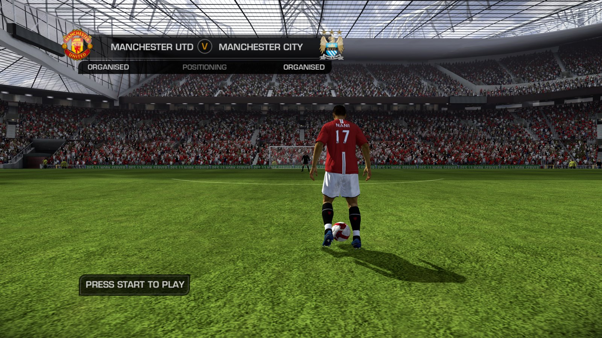
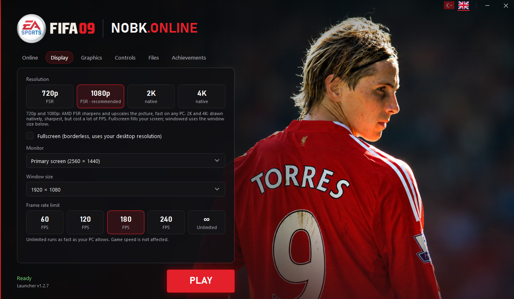
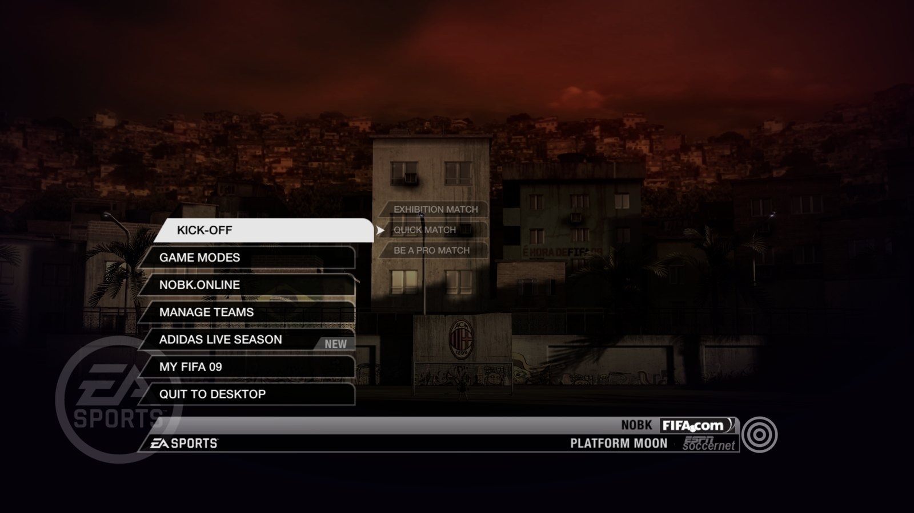

# FIFA 09 PC

[](https://github.com/ChunchunQ/fifa09-recomp/releases/latest)
[](https://github.com/ChunchunQ/fifa09-recomp/releases)


### EA Sports FIFA 09 on PC, running natively, with a modern launcher and its online modes back.

**[⬇ Download for Windows x64](https://github.com/ChunchunQ/fifa09-recomp/releases/latest)**



The Xbox 360 game code is translated to native PC code with the [ReXGlue SDK](https://github.com/rexglue/rexglue-sdk).
Online play runs on the free [NOBK.Online](https://nobkonline.com) servers.
**No game files are included:** you need your own Xbox 360 copy of FIFA 09.

## Highlights

| | |
|---|---|
| **Native PC port** — no emulator, runs at full speed on everyday PCs | **Online again** — ranked 1v1 on NOBK.Online, with MMR, leagues, badges and monthly champions |
| **720p / 1080p with AMD FSR** or native **2K / 4K**, window or fullscreen, any monitor | **Live match feed** — line-ups, goals and cards on [nobkonline.com](https://nobkonline.com) |
| **Frame rate limit** up to unlimited (game speed is not affected) | **Controller or keyboard + mouse** — Xbox or PlayStation button prompts, rebindable keys, the pad works with the window in the background |
| **Achievements** with Xbox 360-style pop-ups | **Launcher** — settings, file check, Add to Steam (Steam Deck too), self-update, one-click log upload |

## Online on NOBK.Online

1. Create a free account at [nobkonline.com](https://nobkonline.com/register/). Your username is your in-game name.
2. Sign in on the launcher's **Online** tab.
3. In the game open **NOBK.Online** from the main menu and pick a **ranked 1v1** match.

Results appear on the site and the leaderboard seconds after the final whistle. No port forwarding, no VPN.

## The launcher



- **Online** — sign in with your NOBK.Online account
- **Display** — 720p / 1080p with AMD FSR or native 2K / 4K, fullscreen or window, monitor, window size, frame rate limit (60 to unlimited)
- **Graphics** — texture filtering, graphics API (Direct3D 12 recommended)
- **Controls** — controller or keyboard + mouse, rebindable keys, Xbox or PlayStation button prompts
- **Files** — game folder, verify game files, Add to Steam, send log
- **Achievements** — everything you unlocked
- English and Turkish, updates itself

## In game



The main menu's **NOBK.Online** entry brings the online modes back.

## Which version you need

The port is built from one specific `default.xex`. Other regions or title updates crash.

| | |
|---|---|
| Game | EA Sports FIFA 09 (Xbox 360) |
| Title ID | `4541085B` |
| `default.xex` SHA-256 | `A6BD02A6A8B15DA801CC05B33BAFA24CD7B1140938BB43FCAEBB30521F37F86B` |

Check yours in PowerShell:

```powershell
(Get-FileHash .\default.xex -Algorithm SHA256).Hash
```

The launcher's **Files → Verify game files** does the same check for you.

## Getting started

**Requirements:** Windows 10 or 11 (64-bit), a DirectX 12 graphics card, a controller or keyboard + mouse,
and the game folder from your own FIFA 09 Xbox 360 disc (`default.xex`, `data0.big` … `data6.big`, `audiodata\`, `data\`).

1. Download `NOBK-FIFA09-<version>.zip` from the [latest release](https://github.com/ChunchunQ/fifa09-recomp/releases/latest) and extract it, e.g. to `C:\Games\FIFA09`
   (not `Program Files`, OneDrive or the Desktop).
2. Copy your game files into the `Game\` folder, so that `Game\default.xex` exists.
3. Start **`FIFA09 Launcher.exe`**. If Windows says "Windows protected your PC": **More info → Run anyway** (the launcher is not code-signed).
4. **Files → Verify game files**, sign in on **Online**, press **PLAY**.

Full guide with launcher settings and troubleshooting: [docs/INSTALL.md](docs/INSTALL.md).
The launcher updates itself; your settings and sign-in are kept.

## Known issues

- Team Play / Be A Pro with 3+ players: the match may not start yet (being worked on).
- "Quit to Desktop" is disabled for now; close the game with **Alt+F4**.

Found a bug? Press **Files → Send log** in the launcher, or open a ticket at
[nobkonline.com → Account → Report a problem](https://nobkonline.com/account/#support).

## Credits

- **EA Canada** for FIFA 09, and **Electronic Arts**
- [ReXGlue SDK](https://github.com/rexglue/rexglue-sdk) and [Xenia](https://xenia.jp), which made the recompilation possible
- AMD FidelityFX Super Resolution (FSR)
- The NOBK.Online community for testing

## Legal

This is a free, non-profit fan project. It is not affiliated with, endorsed or sponsored by Electronic Arts,
EA Sports, FIFA or Microsoft. FIFA 09 and all related names, logos and artwork belong to their respective owners.
This repository contains no game files. You must own the game to use the port.
**Please do not open issues asking for game files.** Rights holders: open an issue and we will act on it promptly.
